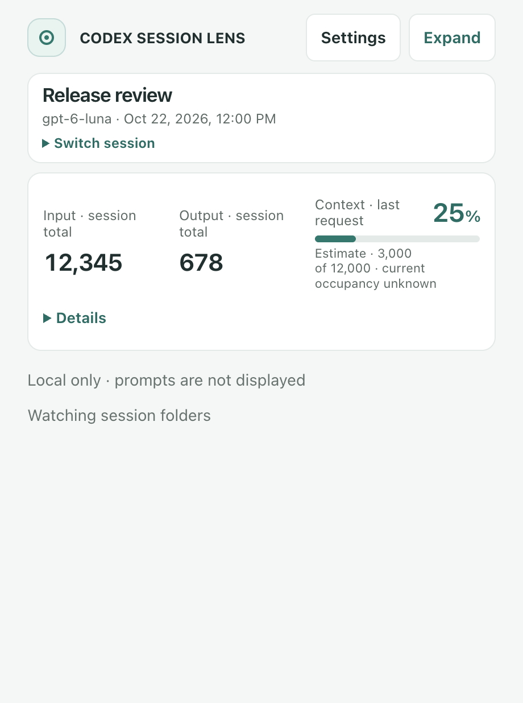
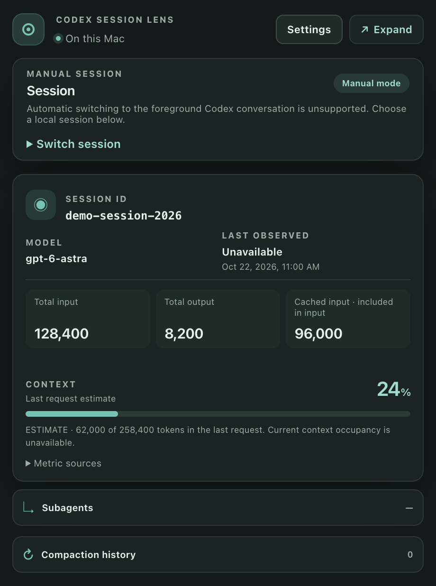

# codex-session-lens
Live session telemetry and context tracking for Codex

A local-first macOS companion HUD for individual Codex sessions. It keeps cumulative usage separate from latest-request usage and shows unknown values as unavailable. It is not affiliated with or endorsed by OpenAI.

## Install

Download the Apple Silicon DMG from [Releases](https://github.com/Ethant35/codex-session-lens/releases), open it and drag **Codex Session Lens** into Applications. Open the app, then choose a session by ID or model. The development release is unsigned and not notarized. If macOS blocks it, review the source and use System Settings → Privacy & Security → Open Anyway for this app. Do not disable system security protections.

Requires Apple Silicon and a macOS version supported by Electron 45. Validated on macOS 27.2; older macOS releases have not been tested. The acceptance environment is recorded in ACCEPTANCE.md. No account, backend, API key or network access is required by the HUD.

## Use

- Search and select a session manually; Cmd+K focuses search. Selection is saved and never changed just because another session becomes active.
- Read cumulative input/output and cached input (a subset of input), with latest-request usage shown separately.
- Context is explicitly a last-request estimate when a complete sample and limit exist. Current effective occupancy is unavailable. Cumulative tokens are never used as context occupancy.
- Expand compaction history and distinguishable child activity. Child metrics stay separate.
- Settings controls system/light/dark theme, always-on-top, source directories, pause/resume, diagnostics and clear history. Compact reduces spacing and hides the latest-request detail strip. Resize and move the window; bounds persist.

## Telemetry sources and limits

The app discovers uncompressed `.jsonl` files in `$CODEX_HOME/sessions` and `$CODEX_HOME/archived_sessions` (default `~/.codex`), or directories you set. It reads `session_meta`, `turn_context`, cumulative `token_count` / `token_usage_record`, compaction and task-status events. [ARCHITECTURE.md](ARCHITECTURE.md) documents fields, provenance and exact accounting rules. Compressed archives, remote-only sessions and undocumented event formats are unsupported. It preserves previously ingested history if a source disappears. Version 1.0.1 makes projection independent of file discovery order and restart boundaries. Conflicting equal-time records are shown as unavailable with a warning. An upgraded v1 cache retains known history and discloses any coverage uncertainty.

**Automatic switching to the selected native Codex conversation is unsupported.** The app uses a first-class manual selector. Activity sorting does not identify the foreground conversation. It does not use Accessibility, inject into Codex, or modify Codex. Search uses session ID and model; prompt-derived titles are deliberately not imported.

Status means last observed status, not a guarantee that a process remains active. Unknown child identity is unavailable. Source changes can make metrics incomplete; diagnostics and warnings expose known problems. All telemetry stays local; see [SECURITY.md](SECURITY.md).

## Build and verify

```sh
git clone https://github.com/Ethant35/codex-session-lens.git
cd codex-session-lens
npm ci
npm run dev
npm run build
npm run package:mac
npm run test:e2e
npm run test:e2e:real
```

Node.js 22.12+ and npm are required. Packaging targets arm64 and writes DMG/ZIP files under `release/`. Real E2E checks require the installed, signed-in Codex CLI and running Codex desktop. Deterministic E2E checks need neither and use temporary synthetic JSONL inputs in the actual packaged app. See [ACCEPTANCE.md](ACCEPTANCE.md) for results and [CONTRIBUTING.md](CONTRIBUTING.md) for the local workflow.

GitHub Actions and CI are intentionally omitted at Ethan's request. Equivalent applicable acceptance runs locally. The original MIT license is preserved.

## Screenshots

Synthetic telemetry, compact light and dark modes:

 
